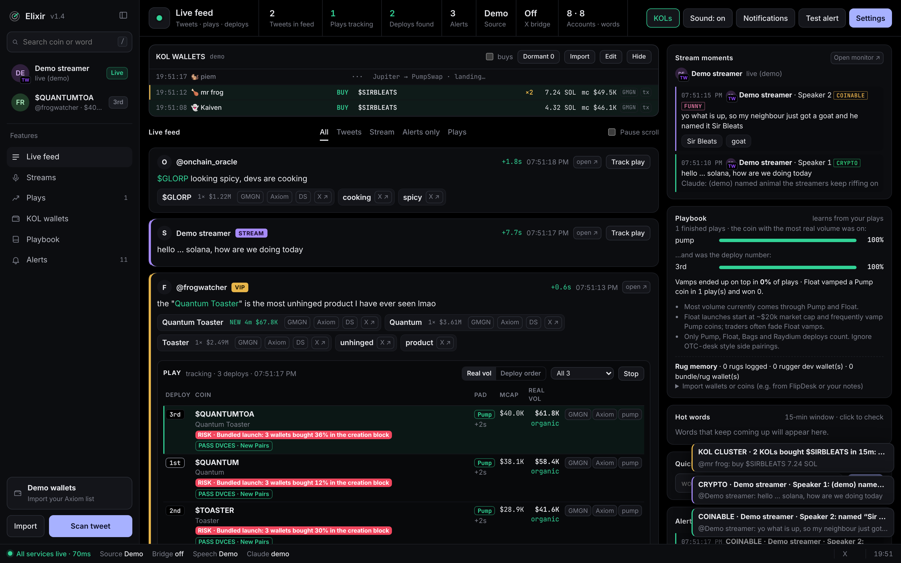
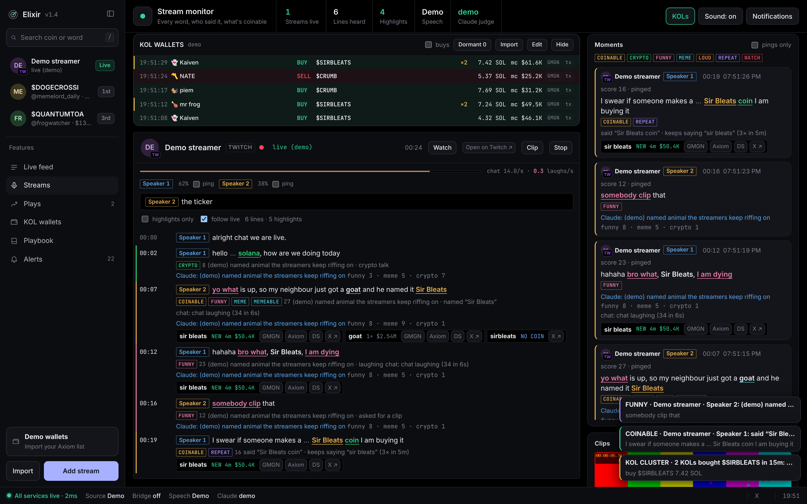

# Elixir

Spots memecoin plays the moment they happen, on X and on live streams, then checks whether a coin already exists.



- **Feed:** tweets from the accounts you track. Play words are pulled out and coin-checked. Big plays get a panel with the 1st/2nd/3rd deploys ranked by real volume, rug/bundle checks, and ticker, image and vamp ideas.
- **Streams:** live transcripts of Twitch, YouTube, X broadcasts and Spaces, Kick, pump.fun, or any browser tab. It shows who's speaking, and funny moments, crypto talk and coin-able names get highlighted and pinged.
- **KOL wallets:** see what tracked wallets buy about half a second after it lands on-chain. Import your Axiom list. Dormant wallets are hidden and ping you when they come back.

> **Read-only.** It never asks for a private key, never trades, and only listens on your own computer (127.0.0.1). Nothing here is financial advice. Memecoins are mostly rugs, so use it at your own risk.

---

## Quick start (about 2 minutes)

1. **Install Node.js 22 or newer** from https://nodejs.org (the LTS button).
2. **Get the code:** on GitHub click the green **Code** button, then **Download ZIP**, and unzip it. With git: `git clone https://github.com/folahanduh/elixir`
3. **Double-click to start:**

   | | Real thing | Demo with fake data |
   |---|---|---|
   | Windows | `start.bat` | `demo.bat` |
   | Mac | `start.command` | `demo.command` |
   | Linux | `./start.sh` | `./start.sh demo` |

   The page opens by itself at **http://localhost:8787**. Use Chrome or Edge. Close the window, or press Ctrl+C, to stop it.

   On a Mac, the first time macOS may say the file is from an unidentified developer. Right-click it, choose **Open**, then **Open** again.

From a terminal it's the same thing: `npm start`, or `npm run demo`.

### Keys (all optional)
It runs with **no keys at all**. Tweets then come from the free X browser bridge or from pasting, and coin checks, rug checks and the demo all work. Add keys to unlock more: copy `.env.example` to `.env`, paste them in, and restart.

| Key in `.env` | Unlocks | Cost |
|---|---|---|
| `SOLANA_WS_URL` | KOL wallet tracking, deeper rug/bundle checks | Free ([Helius](https://helius.dev)) |
| `DEEPGRAM_API_KEY` | Live stream transcription from a link | Free credit ([Deepgram](https://deepgram.com)) |
| `ANTHROPIC_API_KEY` | Claude rates funny or meme-worthy moments, and gives ticker, image and vamp ideas | Pay per use ([Anthropic](https://console.anthropic.com)) |
| `TWITTERAPI_IO_KEY` or `X_BEARER_TOKEN` | Tweets pulled by API instead of the browser bridge | Paid |
| `TELEGRAM_BOT_TOKEN` + `TELEGRAM_CHAT_ID` | Pings on your phone | Free |

Stream capture from a link also needs **ffmpeg** and **yt-dlp** installed (see [Live streams](#3-live-streams-pinpoint-transcription)). Without them, use **Share tab audio** on the Streams page.

---

## Layout




- **Sidebar (left):**
  - Search, the same as Quick check.
  - Everything live right now: running streams with their channel picture and a **Live** tag, and tracked plays with the leading coin's image, mcap and deploy slot.
  - Feature navigation.
  - Your KOL wallet count, and **Import** / **Scan tweet** buttons.
  - Fold it to icons with the button next to the name. On a phone it slides in from the menu button.
- **Header:** stat tiles for the page. On the feed: tweets, plays tracking, deploys found, alerts, source, bridge. On streams: streams live, lines heard, highlights, speech, Claude.
- **Status bar (bottom):** server connection and round-trip time, plus which tweet source, X bridge, speech engine and Claude judge are on.

## 1. Twitter plays: 1st / 2nd / 3rd deploys, ranked by real volume

When a big play lands, the tweet gets a **🎯 PLAY** panel right beside it:

- **Deploys:** every coin launched for it on **Pump, Float, Bags and Raydium** only. Pairs on other pools and odd quote tokens (OTC-desk style pairings) are ignored. Each coin is badged **1st / 2nd / 3rd…** by deploy time and shows how many seconds after the tweet it launched.
- **Ranked by real volume:** the 👑 coin has the most *estimated real* volume. Raw volume is discounted when it looks botted or washed: tiny matched buys and sells (volume bots), a few huge trades against thin liquidity, or volume far above market cap. Hover a number to see why. Switch to **Deploy order** with the toggle. Coins that already existed before the tweet are listed separately.
- **Ticker ideas:** what deployers will probably call it. The ticker the top coin is actually using comes first. Click one to copy it.
- **Likely coin image:** e.g. the tweet's photo, a screenshot of the tweet, or a cartoon of the subject.
- **Image references:** when a play lands, the tracker searches live indexes for what the coin image could be. It then shows thumbnails:
  - The tweet's photo.
  - What deployers actually used.
  - Same-name coins on any chain (DexScreener, millions of tokens).
  - The subject on Wikipedia (animals, people, objects, the memes themselves).
  - Matching meme templates (Imgflip).
  - Established coins and chains (CoinGecko).
  
  With an Anthropic key, Claude looks at the candidates about 45 s in, outlines its pick, and describes the image a deployer will most likely use.
- **🧛 If it gets vamped:** live vamps (the same name relaunched on a *different* launchpad, e.g. Float copying a Pump coin), plus suggested vamps: the name and ticker, the angle, which memecoin or meta it **pairs with** (dog meta → $DOGE/$WIF, frog → $PEPE, penguin → $PENGU, Elon/X meta…), and the launchpad it would most likely land on. Same-launchpad repeats are counted as copies, not vamps.

**When does a tweet become a play?** Click **🎯 Play** on any tweet (or 🎯 on a stream moment). Plays also start automatically when a tweet scores 5+: VIP account (+3), coins already deploying for its words (+3), huge engagement (+3; 1M views or 20k likes), big engagement (+2), watchlist hit (+2). A VIP tweet alone isn't enough, because big accounts tweet all day. Change `plays.autoScore` in `config.json` to make this stricter or looser.

Plays are re-checked every 15 seconds for the first 30 minutes, then every minute for 3 hours. You get a 🚀 ping whenever a new deploy appears. The **🎯 Plays** tab on the Feed shows only plays.

**With an Anthropic key**, Claude reads the tweet (and looks at its image) once per play and writes the ticker, image and vamp suggestions, marked "🤖 Claude". Without a key you get rule-based suggestions.

### ✅ Coin filter (DVCES's settings by default)
Every deploy, and every coin in Quick check, is run through an Axiom-Pulse-style filter. The default is DVCES's setup:

| Column | Rule |
|---|---|
| **New Pairs** | min **$200** volume, max **5 min** old |
| **Final Stretch** | min **$10,000** market cap, min **$5,000** volume, max **30 min** old |
| **Graduated** | min **2 SOL** fees paid |

- Coins get **✅ DVCES · New Pairs** (or Final Stretch / Graduated), **✗ DVCES**, or **✅ passed … earlier** (New Pairs only lasts 5 minutes, so a pass is remembered). Hover a badge to see each check.
- **✅ DVCES only** in the play panel hides everything that never passed.
- You get a **✅ ping** the first time a deploy passes.
- **Fees:** DexScreener doesn't report fees paid, so graduated coins show **≈ Graduated (fees unchecked)**. Confirm the 2 SOL on Axiom.
- **Bonding curve vs graduated:** Pump uses DexScreener's `pumpfun` (curve) vs `pumpswap` (graduated). Bags uses the `DBC` label, and Raydium the `LaunchLab` label. Float's curve marker is unknown, so Float coins are checked against both curve columns. Set `plays.launchpads.float.curve` once you know it.
- Change the numbers in **Settings → Coin filter**, or go back with **Reset to DVCES filter**.

### Rug, bundle and fake-chart checks, with memory
Every deploy in a play gets a risk badge: **RUGGED −94%**, **RISK · reason**, **CAUTION · reason** or **CLEAN**. Hover it for every flag.
- **Bundles:** reads the token's first on-chain buys and flags wallets that bought in the same block the coin was created (e.g. *"4 wallets bought 24% in the creation block"*). Needs `SOLANA_RPC_URL` / `SOLANA_WS_URL`.
- **Dev wallet:** how much the creator bought at launch, how much they still hold, and whether they've already sold most of it.
- **Rug levers (from RugCheck's free API):** mint authority not revoked (the dev can print more tokens), freeze authority on (the dev can stop you selling), top-holder concentration, insider wallet networks, plus RugCheck's own risk list.
- **Fake charts:** volume-bot patterns (tiny matched buys and sells), big volume with very few holders (wash trading), and identical-size bot buys at launch.
- **Memory:** a tracked coin that falls below 15% of its peak (from $20k+), or whose liquidity is pulled, is logged as a **rug**. Its creator and bundle wallets go into `data/risk-memory.json`. The next coin from that dev, or bundled by those wallets, is flagged *"Creator rugged 2 of 3 previous tokens"* / *"3 bundle wallets were in past rugs"*.
  - **Import:** paste your own lists in the Playbook under **Import** (e.g. from FlipDesk or your notes). Use one per line: `creator <wallet>`, `mint <address>`, or a bare wallet for bundlers.
- **One serious flag is enough:** a bundle, a dev dump or a known rugger each make a coin **RISK**.
- **Top clean:** if the #1 coin by real volume is high-risk, the best clean coin is marked **TOP CLEAN**.
- **Show filter:** *All / filter pass / Low risk / Both* hides the rest.
- **Alerts:** you get a ping when the top coin of a play is high-risk, and when a tracked coin rugs.
- **Quick check:** paste any token address to get the full report, or press **Risk** next to a result.

### Playbook: it learns from your plays
Every play is logged (`data/plays.jsonl` at 15 min, 1 h and 3 h; `data/play-outcomes.jsonl` when it ends). The **📒 Playbook** panel then shows which launchpad usually ends up with the top real-volume coin, which deploy slot (1st/2nd/3rd) usually wins, and how often vamps (especially Float vamps of Pump coins) come out on top. These stats are also fed to Claude for future suggestions. Your own trading notes live in `plays.notes` in `config.json` and are passed to Claude too. They're pre-filled with: *most volume is on Pump and Float; Float starts at ~$20k and often vamps Pump coins; ignore OTC-desk pairings.*

### ⚠️ One thing to set up: how Float coins are recognised
Pump coins are recognised by their `…pump` address ending, Bags by `…BAGS`, and Raydium by DexScreener's `raydium` id. I couldn't confirm how DexScreener labels **Float** coins. Open any Float coin on dexscreener.com and look at the address ending and the DEX name. Then fill in `plays.launchpads.float` in `config.json`, for example:
```json
"float": { "label": "Float", "suffixes": ["xxxx"], "dexIds": ["float"], "labels": ["float"], "startMcap": 20000 }
```
Any other launchpad can be added the same way.

## 2. KOL wallets (top-left panel)

The panel sits at the top-left of the main column on both pages. Click **KOLs** in the header (or **KOL wallets** in the sidebar) to show or hide it. It lists what tracked wallets are buying and selling. Buy rows are tinted green and sell rows red. Each row shows the wallet's emoji, and its name in the wallet's highlight colour.

- **How fast:** each wallet is streamed from a Solana RPC websocket at "processed" commitment. You see the swap within about half a second of it landing in a block. That's before it's confirmed, and usually several seconds before GMGN or Axiom show it.
- **First, from the logs:** the row appears straight away as e.g. `alpha  BUY  Pump · landing…`.
- **About a second later:** the transaction is read and the row fills in with the coin, SOL size and market cap, plus GMGN / Axiom / tx links.
- **×2, ×3…** with a gold edge means that many tracked KOLs bought the same coin within 15 minutes. You get a **KOL CLUSTER** alert (sound, pop-up, Telegram). Set `kols.clusterMin` / `kols.clusterMinutes` in `config.json` to change it, and list names in `kols.alertOn` to be pinged on every buy from those KOLs.
- **What counts as a trade:** swaps on Pump, PumpSwap, Raydium (AMM / CPMM / LaunchLab), Meteora (DBC / DAMM) and Jupiter. Plain transfers are ignored.
- **The buys toggle** hides sells. Click a coin to copy it and check it.

**Why not "before it's filled":** Solana has no public mempool, so nobody outside the validators and block engines can see a transaction before it lands. Bots that see pending transactions get them through private access, and they use it to front-run and sandwich. This tracker doesn't do that. "Processed" is the earliest public view there is.

**Setup:**
1. Get a free RPC key with websockets, e.g. Helius (helius.dev).
2. Put `SOLANA_WS_URL=wss://mainnet.helius-rpc.com/?api-key=YOUR_KEY` in `.env` (the HTTP URL is worked out from it).
3. Restart, then load your wallets in one of two ways:
   - **Import (Axiom export):** click **Import** in the panel or sidebar. Paste the whole export, all batches at once with the `===== BATCH` lines left in, or drop the `.json` / `.txt` file on the box. Each wallet keeps its name, emoji, highlight colour, groups and toast setting. Toast off means no pop-up for that wallet's single buys, though it still counts toward clusters. Addresses are taken exactly as exported. Leave **replace list** unticked to merge with the wallets you already have.
   - **Edit:** one per line, `emoji  name  address` (the emoji is optional). Get addresses from the GMGN, Kolscan or Cielo KOL leaderboards.

**Dormant wallets (big lists):**
- On start, each wallet's last transaction is looked up at about 5 per second. A 1,300-wallet list takes roughly 4–5 minutes, and the panel status shows progress. The result is saved in `data/kol-activity.json`, so it only happens once.
- Wallets with **no transaction in 30 days** are hidden from the panel and are **not** streamed. That keeps the socket load down to the wallets that actually trade.
- Dormant wallets are still checked in the background, about every 10 minutes for the whole list. When one moves you get a **BACK ONLINE · 🍕 name moved again after 43 days quiet** alert (sound, pop-up, Telegram). It shows in the panel with a **BACK 43d** tag and is streamed live from then on.
- **Dormant N** in the panel header lists them with how long each has been quiet.
- Active wallets that go quiet for a month drop off on the next 6-hourly re-sort.
- Settings live under `kols` in `config.json`:
  - `dormantDays` (default 30)
  - `scanRps` (lookups per second, default 5; lower it if your RPC rate-limits)
  - `subsPerSocket` (default 250; subscriptions are spread over several websocket connections)
- A free Helius key copes with the activity checks. Hundreds of live subscriptions may need a paid plan, depending on the provider.

## 3. Live streams: pinpoint transcription

### What gets highlighted

Every line the streamer says is transcribed with a timestamp and saved. Each line is scored, and lines over your threshold are highlighted. Big ones ping you (sound, pop-up, desktop notification, Telegram).

| Tag | Fires when |
|---|---|
| 🪙 **COINABLE** | Something gets a name: *"his name is Sir Bleats"*, *"call it…"*, *"we should make a penguin coin"*, *"the ticker should be…"* |
| 💰 **CRYPTO** | Talk about coins, memecoins, tokens, pump.fun, tickers, charts, Dogecoin… |
| 😂 **FUNNY** | The streamer is laughing, says *"I'm dying"* or *"clip that"*, **Twitch chat floods with KEKW / LUL / LMAO**, or Claude rates the line as funny |
| 🐸 **MEME** | Claude rates it as having memecoin-narrative potential |
| 📢 **LOUD** | The streamer suddenly shouts, measured from the real audio level |
| 🔁 **REPEAT** | They keep saying the same word or phrase (a catchphrase forming) |
| 👀 **WATCH** | One of your watchlist words. These ping **while the word is still being spoken**, before the sentence ends |

For each highlighted line, the coin-able words are checked on DexScreener right away. You'll see **NO COIN** / **NEW 3m** / **2× $1.2M**, with GMGN and Axiom buttons. Click any highlighted word to copy it and paste it into Axiom or GMGN.

Twitch chat is read anonymously (no login needed). When chat suddenly laughs, spams one word, or asks for a clip, the lines from the last few seconds get tagged. The word chat is spamming is shown too, because that's often the meme.

Full transcripts are saved in `data/streams/` as both `.txt` (easy to read) and `.jsonl`. Set `"recordAudio": true` in `config.json` to also save the audio as MP3.

### What you need

| | What for | Get it |
|---|---|---|
| **Deepgram API key** (`DEEPGRAM_API_KEY`) | Real-time speech-to-text with word-level timing. Words show within about a second. | https://deepgram.com. New accounts get free credit; after that it's roughly $0.50 per hour of stream (check their pricing page) |
| **yt-dlp + ffmpeg** | Pulls audio straight from a stream link, so you don't need the stream open | Windows: `winget install yt-dlp.yt-dlp` and `winget install Gyan.FFmpeg` · Mac: `brew install yt-dlp ffmpeg` |
| **streamlink** (optional) | Lower-delay audio for Twitch | Windows: `winget install Streamlink.Streamlink` · Mac: `brew install streamlink` |
| **Anthropic API key** (optional, `ANTHROPIC_API_KEY`) | Claude reads each batch of lines and rates how funny, meme-worthy and crypto-related they are, with ticker ideas. Keyword rules can't really tell a joke apart from someone just saying "haha". | https://console.anthropic.com |

The top of the Streams page shows a ✓ or "missing" for each of these.

**Claude cost:** the judge uses `claude-opus-5-5` at low effort, with a call every ~8 seconds while someone is talking. Expect a few dollars per stream-hour. To make it much cheaper, set `"model": "claude-haiku-5-5"` under `streams.judge` in `config.json`. Raising `everySeconds` also cuts cost. Server-side fallback is switched on, so if a request is ever declined by a safety filter, the API retries it on a fallback model automatically.

### Who's speaking, and stutters in real time
- **Speakers:** every word is tagged with who said it (Deepgram's speaker separation, `streams.diarize`). Lines show a coloured name chip, and the bar above the transcript shows each speaker's share of talk time.
  - **Name them:** click a name to rename it, e.g. *Speaker 2 → Elon*.
  - **Ping filter:** tick **ping** next to the people who matter. Only they trigger pings, while everyone is still transcribed and highlighted. With none ticked, everyone pings.
- **Stutters and pauses:** a line keeps growing while the same person keeps talking. A gap longer than 0.7 s is drawn as **…** in place, so *"hello" (2 s) "solana"* shows live as **hello … solana**.
  - **While they're quiet:** the live line shows a trailing **…** until they speak again.
  - **Watch phrases:** these match across the stutter, so a watchlist phrase like `hello solana` pings the moment "solana" is heard.
  - **When a line ends:** after 2.5 s of silence, or when someone else talks.
  - **Tuning:** `streams.pauseMs` and `streams.mergeGapMs` in `config.json`.
- **Speed:** audio goes to speech-to-text in 100 ms chunks, with no ffmpeg buffering. Words show within about 0.3–0.5 s of the audio you receive. The platform's own stream delay still applies (Twitch with streamlink is the lowest).
- Speaker separation needs the link or tab capture (Deepgram). The free mic mode can't tell speakers apart.

### Three ways to capture a stream

1. **Paste a link → ▶ Transcribe** (best). The server pulls the audio itself, so you don't need the stream open. Works for `twitch.tv/name`, YouTube live links, `x.com/i/broadcasts/…`, `x.com/i/spaces/…`, `kick.com/name` and anything else yt-dlp supports. You can run several streams at once.
2. **🖥 Share a tab's audio.** For anything that plays in Chrome (pump.fun streams, sites yt-dlp can't read). Pick the tab and tick **"Also share tab audio"**. It's transcribed with the same accuracy as option 1. Keep that tab open.
3. **🎙 Use my mic (free).** No keys needed. It uses Chrome's built-in speech recognition on your microphone, so it's rougher: no word timing and no loudness detection.

### Auto-start: never miss the start of a stream

- **Auto-watch** (right side of the Streams page): add `twitch.tv/dvces`, `youtube.com/@name/live` and so on. Each channel is checked every 60 seconds. When it goes live you get a 🔴 ping and transcription starts on its own.
- **X live streams and Spaces:** when an account you track on the Feed tweets a live broadcast or Space link, transcription starts automatically. This works through twitterapi.io, the X API or the browser bridge.
- Some X Spaces need you to be logged in. If one fails, add `"ytdlpArgs": ["--cookies-from-browser", "chrome"]` under `streams` in `config.json`.

### Who is streaming: channel pictures
Every stream shows the channel's real profile picture and name. These appear on the stream card, on each moment, in the Auto-watch list, in the feed page's Stream moments and in the sidebar. A small corner mark shows the platform (TW, YT, X, K, N for news).
- **YouTube:** channel name and avatar read with yt-dlp.
- **Twitch and X:** profile picture via unavatar.io. For X broadcasts and Spaces it uses the tweet author's picture.
- **Kick:** the profile picture from Kick's channel API.
- **pump.fun:** the coin image.
- **News and other sites** (Fox News, Sky News, Bloomberg, CNBC, CoinDesk…): the site's logo, with a proper name.

Pictures are downloaded once into `data/avatars/` and refreshed weekly. If one can't be fetched, you see the channel's initials instead, and it retries hourly.

### Watch it and clip it inside the tracker
- **▶ Watch** on a stream card opens the live player right in the tracker (Twitch, YouTube, Kick). **Open on Twitch / YouTube / X / Kick** opens it on the site. X live streams can't be embedded, so they open on X.
- **✂ Clips:** while a stream is captured from its link, the tracker keeps a rolling ~6-minute video buffer (480p, so bandwidth stays low). **Every pinged moment is clipped automatically** (25 s before to 8 s after), and **✂** on any transcript line, or **✂ Clip** on the card, clips it by hand. Clips play in the **Clips** panel and save to `data/clips/` as MP4s you can download. Settings are under `streams.clips` (`enabled`, `autoClip`, `before`, `after`, `quality`).
- Tweets that link to a stream (Twitch, YouTube, Kick, X broadcast or Space) get a **🎙 Transcribe this stream** button.

### Tuning

On the Streams page, under **Sensitivity**:
- **Highlight at score** (default 4): lower it to see more lines.
- **Ping at score** (default 8): lower it to get pinged more often.
- **Language:** pick "Auto / mixed" for streams that switch languages.

Add stream-specific names to `streams.keyterms` in `config.json`. They are also boosted in speech recognition, so unusual names get heard right. Your watchlist words are boosted automatically.

---

## 4. Tweets

Choose one of these, or combine them.

| Option | Cost | Speed | Setup |
|---|---|---|---|
| **A. X browser bridge** | Free | Fast (as fast as X shows it to you) | Tampermonkey + keep one X tab open |
| **B. twitterapi.io** | Pay as you go, roughly $0.15 per 1k tweets | Every 3–10 s | `TWITTERAPI_IO_KEY` in `.env` |
| **C. Official X API** | $200/mo or more (Basic tier) | About every 15 s | `X_BEARER_TOKEN` in `.env` |

**Bridge setup:** install the Tampermonkey extension. With the radar running, open http://localhost:8787/x-bridge.user.js and click Install. Keep an X List of your accounts open in a tab. A "● Radar linked" badge appears bottom-left on X. *If you installed the bridge before, reinstall it to get v1.2: it now passes live-stream links, tweet images and like/view counts through.*

On the Feed, VIP accounts alert on every tweet, and each tweet shows how many seconds it took to reach you. Play words (`$CASHTAGS`, hashtags, "quoted names", Proper Nouns) are coin-checked, and **Hot words** shows what's trending across tweets *and* streams.

---

## 5. Telegram pings (optional)
1. Message **@BotFather** on Telegram, send `/newbot`, and copy the token.
2. Message your new bot once. Then open `https://api.telegram.org/bot<TOKEN>/getUpdates` and copy `chat.id`.
3. Set `TELEGRAM_BOT_TOKEN` and `TELEGRAM_CHAT_ID` in `.env`, restart, and click **Test alert**.

## Settings reference (`config.json`)
- `accounts`, `vip`, `watchlist`, `ignore`, `chains`: also editable in the Feed's Settings.
- `streams.watch`: auto-watched channels (also editable on the Streams page).
- `streams.highlightScore` / `streams.pingScore`: sensitivity.
- `streams.judge`: `enabled`, `model`, `effort`, `everySeconds`.
- `streams.recordAudio`: save MP3s of captured streams.
- `streams.autoFromTweets`: auto-transcribe X live links tweeted by tracked accounts.

## Notes
- Everything runs on your own computer, and the server only listens on `localhost`.
- How far behind live you are depends on the platform. Twitch with streamlink is usually 2–5 s behind the streamer, and YouTube and X can be 5–15 s. Tab sharing is exactly what you're watching.
- "NO COIN" means none is listed *yet*. New pump.fun coins can take a few seconds to a minute to appear on DexScreener.
- This is a research tool, not financial advice. Copycat coins with the same name are common, so always check the contract address.

---

## Contributing

Issues and pull requests are welcome.
- Plain Node.js with no build step: the server is `server.js` plus `lib/`, and the pages are `public/`.
- Run `npm run check` before opening a PR. It syntax-checks everything, runs a few unit checks and boots the demo server. CI runs the same check on Windows, Mac and Linux.
- Never commit `.env`, `config.json` or `data/`. They hold your keys, wallet list and logs, and `.gitignore` already skips them.

## License

MIT. See [LICENSE](LICENSE).
